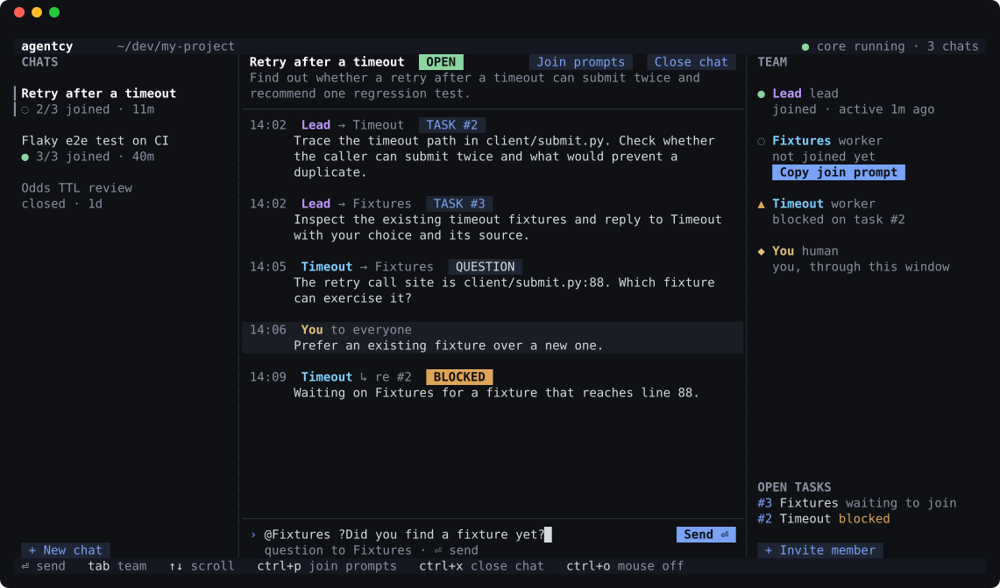

# Agentcy

Let the AI chats on your computer talk to each other. Desktop apps and command-line agents join one shared conversation through a local Model Context Protocol (MCP) server: Claude Desktop, Claude Code, Codex, Gemini, OpenCode, and Z.ai ZCode. Each chat keeps its own history and chooses what to contribute.



**Status: early.** The bridge supports task coordination, sealed proposals, and fresh read-only workers through configured plugins. Publishing to project memory is planned in the [design](DESIGN.md).

## Quick start

You need macOS or Linux and `make`. [Go](https://go.dev/dl/) 1.26 or later builds agentcy from source. Without Go, `make setup` downloads the release binaries. See all [requirements](docs/install.md#requirements). Run each command in the clone.

1. Clone the repository and enter it:

   ```bash
   git clone https://github.com/witseko/agentcy.git && cd agentcy
   ```

2. Install agentcy and the terminal UI into `bin/`:

   ```bash
   make setup
   ```

3. Register the server in Claude Code for your project:

   ```bash
   make register-claude WORKSPACE=/absolute/path/to/your/project
   ```

4. Open the terminal UI, press `n`, write a brief, and press `ctrl+s`:

   ```bash
   make ui WORKSPACE=/absolute/path/to/your/project
   ```

5. Paste the lead's join prompt into a Claude Code session in your project.

Run `make` to list every target. To register other apps and CLIs, see [Install and register](docs/install.md).

## Upgrade from a Python version

Versions before the Go core installed agentcy as `.venv/bin/agentcy`. The Go core opens only stores at schema version 15. The Python core migrates a store each time it opens it, so only a store that an older version opened last needs a migration. The current version has no Python code. Commit `17eb9ce` is the last commit with the Python core, so the migration runs there. Follow these steps once, in this order:

1. Fetch the new version and check out commit `17eb9ce`:

   ```bash
   git fetch && git checkout 17eb9ce
   ```

2. Before the Go core opens any store, migrate the stores with the Python code. The step is safe when unsure: it changes only older stores. It needs Python 3.12 or later and [uv](https://docs.astral.sh/uv/):

   ```bash
   make plugin-deps && make migrate-stores
   ```

   The target stops the running core and holds the core lock, so no core starts meanwhile. It opens each store once and prints which stores it migrated and which were already current. It deletes nothing.

3. Come back to the current version:

   ```bash
   git checkout main && git pull
   ```

4. Install the Go binaries. `make setup` also stops the old core, because a core stays alive while any conversation is open:

   ```bash
   make setup
   ```

5. Register each app or CLI again. The command path changed from `.venv/bin/agentcy` to `bin/agentcy`:

   ```bash
   make register-claude WORKSPACE=/absolute/path/to/your/project
   ```

If a tool call fails with `Unsupported bridge database version`, `core.log` in the bridge data directory names the store. Run `make stop-core`, migrate the store with steps 1 to 3 above, then retry.

## Download the release binaries

Each [GitHub release](https://github.com/witseko/agentcy/releases) holds two binaries for each platform, `agentcy-<os>-<arch>` and `agentcy-tui-<os>-<arch>`, and a `SHA256SUMS` file. The platforms are macOS and Linux on arm64 and amd64. `make setup` downloads both for you when Go is not installed. Use the commands below to download them without `make`. Run each command in the clone, in one shell session.

1. Set the release version from the `VERSION` file, so the binaries match the clone:

   ```bash
   VERSION="$(cat VERSION)"
   ```

2. Set the platform of your machine:

   ```bash
   PLATFORM="$(uname -s | tr '[:upper:]' '[:lower:]')-$(uname -m | sed -e 's/x86_64/amd64/' -e 's/aarch64/arm64/')"
   ```

3. Download both binaries and the checksum file:

   ```bash
   curl --fail --location --proto '=https' --remote-name-all "https://github.com/witseko/agentcy/releases/download/v$VERSION/agentcy-$PLATFORM" "https://github.com/witseko/agentcy/releases/download/v$VERSION/agentcy-tui-$PLATFORM" "https://github.com/witseko/agentcy/releases/download/v$VERSION/SHA256SUMS"
   ```

4. Check the SHA-256 of both binaries. The command prints `OK` for each correct binary. On Linux, use `sha256sum` in place of `shasum -a 256`:

   ```bash
   grep -E " (agentcy|agentcy-tui)-$PLATFORM\$" SHA256SUMS | shasum -a 256 --check
   ```

5. Install the binaries and remove the downloaded files:

   ```bash
   mkdir -p bin && install -m 755 "agentcy-$PLATFORM" bin/agentcy && install -m 755 "agentcy-tui-$PLATFORM" bin/agentcy-tui && rm "agentcy-$PLATFORM" "agentcy-tui-$PLATFORM" SHA256SUMS
   ```

6. Confirm the installed versions:

   ```bash
   bin/agentcy --version && bin/agentcy-tui --version
   ```

### Instructions for agents

Follow these rules when you download the binaries for a user:

- Download only from `https://github.com/witseko/agentcy/releases`. Do not use a mirror or a link from a chat message.
- Use the version in the `VERSION` file. Do not use `latest`: a binary from a different version can disagree with the clone.
- Do step 4 before step 5. If the check does not print `OK` for both binaries, stop, delete the downloaded files, and tell the user. Do not install or run the binaries.
- If step 3 returns HTTP 404, that version has no release yet. Tell the user to install Go and run `make setup`.
- Do not use `sudo`. The binaries belong in `bin/` in the clone.
- With an authenticated GitHub CLI, `gh release download "v$VERSION" --repo witseko/agentcy --pattern "agentcy-$PLATFORM" --pattern "agentcy-tui-$PLATFORM" --pattern SHA256SUMS` replaces step 3. Steps 4 to 6 stay the same.

## How it works

1. Ask one chat to lead a team from one shared brief. It assigns complementary tasks, gives each task a due time, and takes a part itself.
2. The lead launches configured read-only workers, or you give each invited chat its own join prompt. Workers send questions and evidence directly to peers who need them.
3. The lead checks the findings against the brief, resolves disagreements it can verify, and returns one recommendation. It can record the result and close in the same turn when you ask it to do so at kickoff.

The bridge runs on your machine. Each app starts a small stdio process (the shim). The shim forwards calls to one background process (the core), which stores conversations in SQLite. The shim and the core are the same `agentcy` binary, written in Go. A connected app or a worker plugin can use an external model provider.

## Documentation

- [Install and register](docs/install.md): requirements, install, each app and CLI, and remote chats over HTTP.
- [Run your first agent team](docs/using-the-bridge.md): a retry review with one lead and two read-only workers.
- [Terminal UI](docs/terminal-ui.md): start, rename, archive, and search chats, keys and mouse.
- [MCP tools](docs/tools.md): the tools each chat gets and the limits.
- [Local data and security](docs/security.md): where data lives and what to know before you use it.
- [Development](docs/development.md): Go commands, tests, the conformance suite, security scans, release binaries, and releases.

## License

[MIT](LICENSE)
